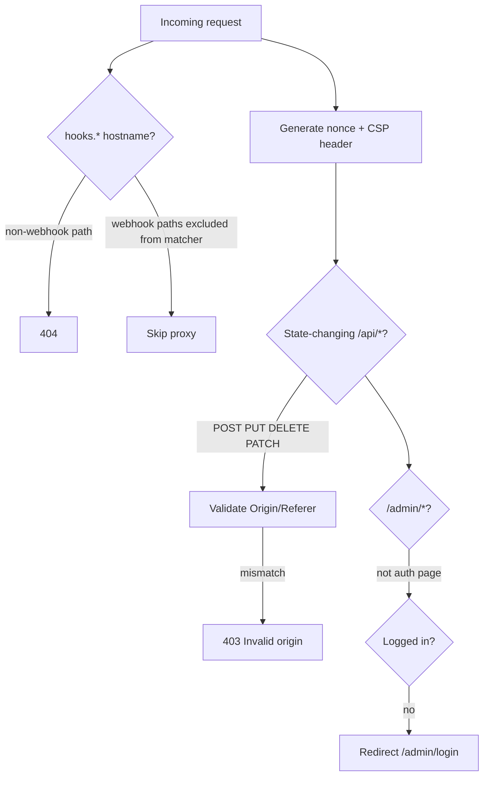

# Auth and Security

> Category: Architecture | Version: 1.0 | Date: May 2026 | Status: Active

Authentication (NextAuth v5 credentials + TOTP), session protection, CSP/CSRF via `proxy.ts`, API key gates, and admin security endpoints.

**Related:**
- [`proxy.ts`](../../../proxy.ts)
- [`lib/auth.ts`](../../../lib/auth.ts)
- [`lib/auth.config.ts`](../../../lib/auth.config.ts)
- [`guides/locked-business-rules.md`](../guides/locked-business-rules.md)

---

## Overview

Admin access is **invite-only**. There is no public signup. First user is bootstrapped via `scripts/create-admin.ts` or SQL (see [`guides/local-development.md`](../guides/local-development.md)).

Unauthenticated webhook and cron routes bypass session auth but use **signature secrets** or **API keys** instead.

---

## NextAuth architecture

| Module | Runtime | Responsibility |
|---|---|---|
| `lib/auth.config.ts` | Edge-safe | Session strategy, pages, callbacks without Node-only imports |
| `lib/auth.ts` | Node | Full NextAuth + Credentials provider + bcrypt + TOTP + audit log |
| `app/api/auth/[...nextauth]/route.ts` | Node | Auth HTTP handlers |
| `proxy.ts` | Edge | Uses `NextAuth(authConfig)` only — never imports `lib/auth.ts` |

**Credentials flow:**

1. User submits email + password (+ optional TOTP) on `/admin/login`.
2. `authorize()` loads `admin_users`, verifies bcrypt hash, checks lockout counters.
3. If TOTP enabled, validates code via `otplib` `verifySync`.
4. JWT session issued; `admin_audit_log` records login/logout events.

**Roles:** Stored on `admin_users.role` — e.g. `super_admin`, `admin`. Enforced per-route in API handlers and UI.

---

## TOTP (2FA)

- Secret stored encrypted on `admin_users` (see encryption module).
- Backup codes in `admin_users.backupCodes` array.
- Admin UI: **Settings → Security → TOTP** via `/api/admin/security/totp`.
- Tests: `app/__tests__/security/authentication.test.ts`.

---

## proxy.ts — CSP, CSRF, route protection

**CSP:** `lib/security/csp-nonce.ts` builds nonce-based policy; nonce forwarded on request headers so Next.js inline scripts comply.

**CSRF:** State-changing API requests must match `Origin` or `Referer` against host + `NEXT_PUBLIC_SITE_URL` + `NEXTAUTH_URL`.

**Excluded from proxy matcher:** Webhook routes (`/api/webhooks/*`, `/api/outreach/webhooks/*`) and outreach import paths — they use their own auth (signatures / API keys).

---

## API key authentication

Internal/cron routes gate with constant-time comparison:

- `lib/auth/compare-api-keys.ts` — `compareApiKeys`, `compareBearerToken` using `crypto.timingSafeEqual`.
- Env vars: `NEWSLETTER_API_KEY`, `OUTREACH_API_KEY`, `CRON_SECRET`, `OUTREACH_CRON_SECRET`.

Tests: `lib/auth/__tests__/compare-api-keys.test.ts`.

Typical pattern: `Authorization: Bearer <secret>` or `x-api-key` header checked before handler logic.

---

## Webhook signature verification

| Webhook | Secret env | Verifier |
|---|---|---|
| Cal.com | `CAL_WEBHOOK_SECRET` | HMAC-SHA256 (`app/api/webhooks/cal/route.ts`) |
| Resend | `RESEND_WEBHOOK_SECRET` | Svix headers (`lib/outreach/webhooks/`) |

Tests: `app/__tests__/security/webhook-signature.test.ts`.

---

## Admin security API

| Endpoint | Purpose |
|---|---|
| `POST /api/admin/security/password` | Change password |
| `POST /api/admin/security/reset-password` | Reset via token |
| `GET/POST /api/admin/security/totp` | Enable/disable 2FA |
| `GET/DELETE /api/admin/security/sessions` | List/revoke sessions |

---

## Encryption

- `INTEGRATION_ENCRYPTION_KEY` — encrypts integration credentials at rest.
- `lib/encryption.ts` — used by auth and Cloudflare credential storage.
- Tests: `lib/__tests__/encryption.test.ts`.

---

## Input validation

- `lib/security/input-validation.ts` — shared sanitization/validation helpers.
- Tests: `lib/security/__tests__/input-validation.test.ts`.
- HTML email bodies sanitized via `isomorphic-dompurify` where rendered.

---

## Related docs

- [`api/admin-api.md`](../api/admin-api.md)
- [`api/webhooks-and-cron.md`](../api/webhooks-and-cron.md)
- [`deployment.md`](deployment.md)

---

## Changelog

- v1.0 (2026-05) — Initial auth/security reference.
