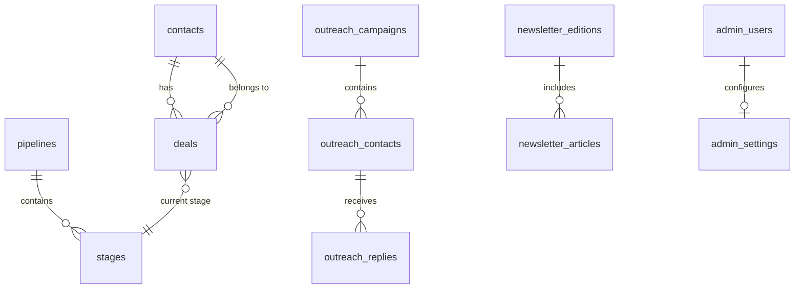

# Database Schema

> Category: Architecture | Version: 1.0 | Date: May 2026 | Status: Active

Drizzle ORM schema for PostgreSQL: **46 tables** in `lib/db/schema.ts`, grouped by domain, plus PostgreSQL RPC functions used for hierarchy-safe CRM writes and bulk operations.

**Related:**
- [`crm-pipeline.md`](crm-pipeline.md)
- [`lib/db/schema.ts`](../../../lib/db/schema.ts)
- [`lib/db/relations.ts`](../../../lib/db/relations.ts)

---

## Overview

- **ORM:** Drizzle with camelCase TypeScript field names mapped to snake_case PostgreSQL columns.
- **Client:** `db` from `@/lib/db` — `import "server-only"`; never import in Client Components.
- **Migrations:** `lib/db/drizzle/` — apply with `bun run db:migrate` only in production; `db:push` is local throwaway only (see [`../database/schema-and-migrations.md`](../database/schema-and-migrations.md)).
- **Queue schema:** pg-boss creates and manages the `pgboss` schema automatically on worker boot.

Query convention: Drizzle uses camelCase (`contacts.firstName`). API responses often map to snake_case for JSON clients — see [`api/api-overview.md`](../api/api-overview.md).

---

## Table inventory (46)

### Admin & authentication (9)

| Table | Drizzle export | Purpose |
|---|---|---|
| `admin_users` | `adminUsers` | Admin accounts, password hash, TOTP secret, roles |
| `admin_sessions` | `adminSessions` | Session tracking for security UI |
| `admin_invitations` | `adminInvitations` | Invite-only onboarding tokens |
| `admin_settings` | `adminSettings` | Per-user theme, timezone, notification prefs |
| `admin_audit_log` | `adminAuditLog` | Security and admin action audit trail |
| `password_reset_tokens` | `passwordResetTokens` | Password reset flow |
| `oauth_states` | `oauthStates` | OAuth CSRF state (integrations) |
| `integrations` | `integrations` | Third-party integration registry |
| `integration_credentials` | `integrationCredentials` | Encrypted credentials (`INTEGRATION_ENCRYPTION_KEY`) |

### CRM (9)

| Table | Drizzle export | Purpose |
|---|---|---|
| `contacts` | `contacts` | CRM contacts, status hierarchy, enrichment |
| `deals` | `deals` | Pipeline deals linked to contacts |
| `pipelines` | `pipelines` | Pipeline definitions (default: `sales-pipeline`) |
| `stages` | `stages` | Stage rows per pipeline (Lead → Won/Lost) |
| `deal_stage_history` | `dealStageHistory` | Stage transition audit |
| `contact_pipeline_stages` | `contactPipelineStages` | Contact ↔ stage junction |
| `contact_timeline` | `contactTimeline` | Activity timeline events |
| `contact_submissions` | `contactSubmissions` | Inbound form submissions (Cal.com linkage) |
| `crm_sync_queue` | `crmSyncQueue` | Retries for async CRM sync operations |

### Outreach (8)

| Table | Drizzle export | Purpose |
|---|---|---|
| `outreach_campaigns` | `outreachCampaigns` | Campaign config, templates, stats. `created_at` / `updated_at` NOT NULL DEFAULT now() (migration 0009) |
| `outreach_contacts` | `outreachContacts` | Per-campaign leads, send state, Resend message IDs. `created_at` NOT NULL DEFAULT now() (migration 0009) |
| `outreach_replies` | `outreachReplies` | Inbound replies, AI analysis, thread metadata |
| `outreach_email_events` | `outreachEmailEvents` | Opens, clicks, bounces from Resend |
| `outreach_schedules` | `outreachSchedules` | Business hours / timezone schedules |
| `outreach_sender_accounts` | `outreachSenderAccounts` | From-address mailboxes |
| `outreach_campaign_senders` | `outreachCampaignSenders` | Campaign ↔ sender junction |
| `outreach_blocklist` | `outreachBlocklist` | Suppression list |

> **Migration 0009** (`lib/db/drizzle/0009_outreach_timestamps_not_null.sql`): backfilled and locked `created_at` / `updated_at` on `outreach_campaigns` and `created_at` on `outreach_contacts`. Expand → backfill (`COALESCE(added_to_campaign_at, now())` for contacts) → NOT NULL.

### Newsletter (7)

| Table | Drizzle export | Purpose |
|---|---|---|
| `newsletter_subscribers` | `newsletterSubscribers` | Subscriber list + status |
| `newsletter_editions` | `newsletterEditions` | Published/draft editions |
| `newsletter_articles` | `newsletterArticles` | Curated article rows |
| `newsletter_campaigns` | `newsletterCampaigns` | Send campaigns / batches |
| `newsletter_send_queue` | `newsletterSendQueue` | Per-recipient send queue rows |
| `newsletter_events` | `newsletterEvents` | Delivery/open/click events |
| `newsletter_settings` | `newsletterSettings` | Global newsletter config |

### Site content & misc (7)

| Table | Drizzle export | Purpose |
|---|---|---|
| `site_settings` | `siteSettings` | Global site/branding settings |
| `blog_posts` | `blogPosts` | Admin blog content |
| `faqs` | `faqs` | FAQ entries |
| `partners` | `partners` | Partner logos/links |
| `testimonials` | `testimonials` | Testimonial content |
| `email_replies` | `emailReplies` | Generic email reply storage |
| `notifications` | `notifications` | In-app notification feed |

### Chat (legacy / scaffold) (6)

| Table | Drizzle export | Purpose |
|---|---|---|
| `chats` | `chats` | Chat sessions |
| `chat_messages` | `chatMessages` | Messages |
| `chat_documents` | `chatDocuments` | RAG documents |
| `chat_streams` | `chatStreams` | Stream IDs |
| `chat_suggestions` | `chatSuggestions` | Suggested prompts |
| `chat_votes` | `chatVotes` | Message votes |

These tables exist in schema for forward compatibility; the admin product surface is CRM/outreach/newsletter-focused.

---

## Key relationships



**Foreign keys** are defined in Drizzle schema and enforced in PostgreSQL. Relation helpers live in `lib/db/relations.ts` for query ergonomics.

---

## PostgreSQL RPC functions

Called via `db.execute(sql\`...\`)` with named parameters (`:=`). Defined in `lib/db/drizzle/0011_crm_rpc_functions.sql` (apply with `bun run db:migrate` or run that file on Railway if CRM contact create returns 500).

| Function | Used by | Purpose |
|---|---|---|
| `upsert_contact_with_hierarchy_protection` | `lib/outreach/crm/push-to-crm.ts`, `lib/crm-retry-queue.ts` | Insert/update contact without downgrading status (subscriber < lead < qualified < customer) |
| `update_contact_and_deal_for_booking` | `app/api/webhooks/cal/route.ts` | Cal.com booking → qualified contact + Meeting Booked deal |
| `bulk_add_tags` | `lib/crm/contacts.ts` | Tag many contacts atomically |
| `bulk_delete_contacts` | CRM bulk delete API | Delete many contacts |
| `get_crm_metrics` | `lib/crm/metrics.ts` | Dashboard metrics RPC (with TS fallback) |
| `get_crm_dashboard_data` | Admin dashboard queries | Aggregated dashboard payload |
| `increment_sender_count` | Outreach sending stats | Sender daily counters |
| `update_campaign_stats` | Campaign performance | Roll up send/reply stats |
| `get_unique_tags` | CRM tag picker | Distinct tag list |

Example call site (hierarchy-safe upsert):

```typescript
// lib/outreach/crm/push-to-crm.ts
await db.execute(sql`
  SELECT * FROM upsert_contact_with_hierarchy_protection(
    p_email := ${contact.email},
    p_first_name := ${contact.firstName || null},
    ...
    p_contact_status := 'lead',
    p_source := 'outreach_reply'
  )
`);
```

---

## Realtime

`lib/db/drizzle/0003_inbox_realtime_notify.sql` defines `notify_outreach_reply_inserted()` — PostgreSQL `NOTIFY` on new inbox rows for SSE (`lib/realtime/`).

---

## Related code

- `lib/db/schema.ts` — all table definitions
- `lib/db/index.ts` — connection pool
- `scripts/seed-crm-pipeline.ts` — seeds `sales-pipeline` + stages
- `drizzle.config.ts` — Drizzle Kit config

---

## Changelog

- v1.1 (2026-05-28) — Added `0011_crm_rpc_functions.sql` (upsert, booking sync, bulk tags/delete). Required for manual contact create and newsletter CRM sync.
- v1.0 (2026-05) — Initial inventory for template-crm schema.
