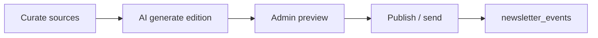

# Newsletter Pipeline

> Category: Architecture | Version: 1.0 | Date: May 2026 | Status: Active

Curate → generate → publish workflow for newsletter editions, subscriber sends, and queue-backed batch delivery.

**Related:**
- [`queue-and-worker.md`](queue-and-worker.md)
- [`lib/newsletter/`](../../../lib/newsletter/)

---

## Overview

The newsletter engine pulls content from configurable sources (RSS, Hacker News, Reddit), scores and summarizes articles, generates an edition with AI, and publishes via Resend to `newsletter_subscribers`.

---

## Workflow stages

| Stage | Trigger | Processor |
|---|---|---|
| Curate | API `POST /api/newsletter/curate` or worker job | `lib/newsletter/lib/queue/jobs/curate-job.ts` |
| Generate | API `POST /api/newsletter/generate` | `processGenerateJob` |
| Publish | API send routes or `newsletter-publish` queue | `processPublishJob` |
| Cleanup | `newsletter-cleanup` queue | `processCleanupJob` |

Full send pipeline can run as one `newsletter-send` job (curate + generate + publish chain in `scripts/worker.ts`).

---

## Data model

| Table | Role |
|---|---|
| `newsletter_subscribers` | Audience; status/unsubscribe |
| `newsletter_editions` | Draft/published edition metadata + HTML |
| `newsletter_articles` | Curated article rows linked to edition |
| `newsletter_campaigns` | Batch send grouping |
| `newsletter_send_queue` | Per-recipient outbound queue |
| `newsletter_events` | Delivery analytics |
| `newsletter_settings` | From name, schedule, source config |

---

## Content sources

Modules under `lib/newsletter/modules/sources/`:

- RSS (`rss.ts`)
- Hacker News (`hackernews.ts`)
- Reddit (`reddit.ts`)

Orchestration: `lib/newsletter/modules/orchestrator/multi-source-fetcher.ts`

Processing: filter, scorer, summarizer under `lib/newsletter/modules/processing/`

Tests in each module's `__tests__/` folder.

---

## Email delivery

- Templates: `lib/newsletter/emails/`, React Email components
- Resend client passed into publish job
- Rate limiting: `lib/newsletter/modules/publishing/rate-limiter.ts`
- Retry/resilience: `lib/newsletter/lib/resilience/`

From address: `NEWSLETTER_FROM_EMAIL` env var.

---

## Admin UI

- `/admin/newsletter` — editions list, editor, send controls
- Preview: `GET /api/newsletter/[id]/preview`
- Stats: `GET /api/newsletter/stats`

---

## Scheduling

- HTTP cron: `GET /api/cron/newsletter-schedule` with `CRON_SECRET`
- Queue stats: `GET /api/newsletter/queue/stats`

---

## API key gate

Some newsletter automation routes require `NEWSLETTER_API_KEY` (Bearer or x-api-key) — see [`api/newsletter-api.md`](../api/newsletter-api.md).

---

## Related code

- `app/api/newsletter/`
- `lib/queue/index.ts` — enqueue helpers
- Tests: `app/api/newsletter/__tests__/`, `lib/newsletter/lib/queue/__tests__/`

---

## Related docs

- [`requirements/features/feature-004-newsletter-engine/`](../../requirements/features/feature-004-newsletter-engine/)

---

## Changelog

- v1.0 (2026-05) — Initial newsletter pipeline doc.
