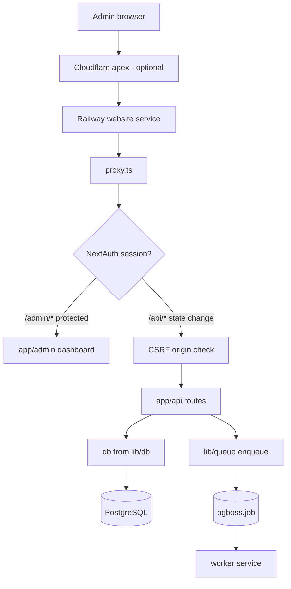

# System Overview

> Category: Architecture | Version: 1.1 | Date: May 2026 | Status: Active

High-level map of **template-crm**: three Railway services, admin-only web app, PostgreSQL + pg-boss, and external integrations (Resend, Anthropic, Cal.com, Cloudflare, S3-compatible storage).

**Related:**
- [`deployment.md`](deployment.md)
- [`database-schema.md`](database-schema.md)
- [`../database/schema-and-migrations.md`](../database/schema-and-migrations.md)
- [`queue-and-worker.md`](queue-and-worker.md)
- [`../api/routes-overview.md`](../api/routes-overview.md)
- [`../outreach/pipeline-and-reply-flow.md`](../outreach/pipeline-and-reply-flow.md)
- [`../auth/admin-auth.md`](../auth/admin-auth.md)
- [`README.md`](../../../README.md)

---

## Overview

template-crm is a **forkable admin platform** — not a public marketing site. The root route (`app/page.tsx`) redirects to `/admin`. All product value lives behind NextAuth credentials + optional TOTP.

Three deployable units share one GitHub repo and one PostgreSQL database:

| Service | Runtime | Start command | Role |
|---|---|---|---|
| **website** | Docker → Node standalone | `node .next/standalone/server.js` | Next.js 16 App Router — HTTP, API routes, admin UI |
| **worker** | Docker → Bun | `bun scripts/worker.ts` | pg-boss consumer — outreach sends, newsletter pipeline, scheduled outreach batch |
| **Postgres** | Railway managed | — | App data + `pgboss` schema |

Push to `main` redeploys **website** and **worker** in parallel.

---

## Request path (website)



**Edge proxy:** `proxy.ts` replaces legacy `middleware.ts` in Next.js 16. It wraps NextAuth (`authConfig`), injects per-request CSP nonces, enforces CSRF on state-changing API calls, and protects `/admin/*` except login/invite/reset-password routes.

**Webhook hostname lockdown:** Requests to `hooks.*` / `webhooks.*` hostnames that are not webhook paths return 404 at the proxy layer. Cal.com and Resend webhooks use a **grey-cloud** `hooks.__YOUR_DOMAIN__` CNAME — see [`cloudflare-integration.md`](cloudflare-integration.md) and [`deployment.md`](deployment.md).

**Cal.com subscriber URL (locked):** `https://hooks.__YOUR_DOMAIN__/api/webhooks/cal` — never orange-cloud the `hooks` CNAME. See [`../outreach/pipeline-and-reply-flow.md`](../outreach/pipeline-and-reply-flow.md) and `app/api/webhooks/cal/README.md`.

---

## pg-boss queue pattern

The **website** enqueues; the **worker** consumes. Both use the same `DATABASE_URL`; pg-boss stores jobs in the `pgboss` schema (created on first worker boot).

| Step | Where |
|---|---|
| Define queue names | `lib/queue/index.ts` (`QUEUE` constant) |
| Enqueue from API/cron | `enqueueNewsletterSend`, `enqueueOutreachSendEmail`, etc. |
| Register handlers | `scripts/worker.ts` — `boss.work()` per queue |
| Outreach batch cron | `outreach-process` schedule `*/5 * * * *` in worker |

Without the worker service, outreach sequences and newsletter pipelines stall after enqueue. Details: [`queue-and-worker.md`](queue-and-worker.md).

---

## Major subsystems

| Subsystem | UI | API prefix | Background work |
|---|---|---|---|
| CRM | `/admin/crm`, pipeline kanban | `/api/crm/*` | `crm_sync_queue` + cron |
| Outreach | `/admin/outreach` | `/api/outreach/*` | `outreach-send-email`, `outreach-process` cron |
| Inbox | `/admin/inbox` | `/api/outreach/replies/*` | AI analyzer on inbound webhook |
| Newsletter | `/admin/newsletter` | `/api/newsletter/*` | `newsletter-*` queues |
| Admin / settings | `/admin/settings/*` | `/api/admin/*` | — |
| Cloudflare admin | Settings → Cloudflare | `/api/admin/cloudflare/*` | — |
| Media | Settings uploads | `/api/media/*`, `/api/admin/upload/*` | S3 via `lib/storage` |

Deep dives: [`crm-pipeline.md`](crm-pipeline.md), [`outreach-pipeline.md`](outreach-pipeline.md), [`newsletter-pipeline.md`](newsletter-pipeline.md).

---

## Data flow (simplified)

```
Outreach campaign created
  → contacts imported → pg-boss outreach-send-email jobs
  → Resend sends sequence 1/2/3
  → Resend webhook → reply stored → AI analysis → inbox UI
  → positive reply → pushToCrm (RPC upsert) → deal at Contacted

Cal.com BOOKING_CREATED (hooks subdomain)
  → /api/webhooks/cal → update_contact_and_deal_for_booking RPC
  → contact qualified + deal Meeting Booked

Newsletter edition
  → curate → generate → publish (worker or API-triggered queues)
  → Resend batch send → newsletter_events
```

---

## Technology stack

| Layer | Choice |
|---|---|
| Runtime | Bun 1.3+ (dev/build); Node 22+ for production standalone server |
| Framework | Next.js 16 App Router, React 19 |
| Styling | Tailwind CSS v4, shadcn/ui |
| ORM | Drizzle + `postgres.js` |
| Auth | NextAuth v5 credentials + TOTP (`otplib`) |
| Email | Resend |
| AI | Anthropic (`@ai-sdk/anthropic`, `@anthropic-ai/sdk`) |
| Queue | pg-boss 12.x (same Postgres) |
| Storage | AWS SDK S3 client → MinIO (local) / Tigris (Railway Bucket) |
| Lint | Biome |
| Tests | Vitest (1300+ tests) |

---

## Related code

- `app/page.tsx` — redirect to `/admin`
- `app/admin/(dashboard)/` — main product UI
- `app/api/` — REST surface
- `proxy.ts` — auth, CSP, CSRF, webhook host guard
- `lib/db/index.ts` — Drizzle client (`server-only`)
- `lib/queue/index.ts` — typed enqueue helpers
- `scripts/worker.ts` — pg-boss handlers

---

## Related docs

- [`auth-and-security.md`](auth-and-security.md)
- [`guides/local-development.md`](../guides/local-development.md)
- [`requirements/features/feature-001-crm-pipeline/`](../../requirements/features/feature-001-crm-pipeline/)

---

## Changelog

- v1.1 (2026-05) — pg-boss pattern section; links to migrations, routes, outreach locks, admin auth.
- v1.0 (2026-05) — Initial template-crm system overview.
