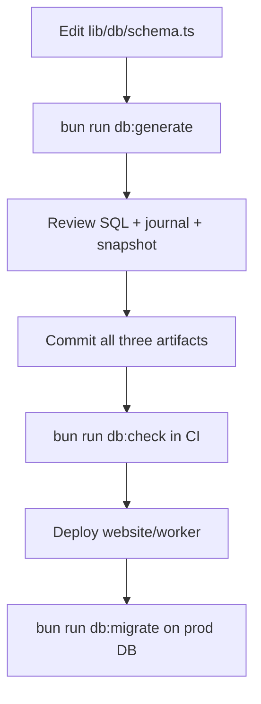

# Schema and Migrations

> Category: Architecture | Version: 1.0 | Date: May 2026 | Status: Active

Drizzle migration workflow for template-crm: migrate-only policy in production, journal + snapshot requirements, CI drift guard, and context for migrations `0013`–`0015`.

**Related:**
- [`../architecture/database-schema.md`](../architecture/database-schema.md)
- [`../../requirements/features/feature-009-schema-drift-recovery/prd-feature-009-schema-drift-recovery.md`](../../requirements/features/feature-009-schema-drift-recovery/prd-feature-009-schema-drift-recovery.md)
- [`lib/db/schema.ts`](../../../lib/db/schema.ts)
- [`lib/db/drizzle/meta/_journal.json`](../../../lib/db/drizzle/meta/_journal.json)
- [`scripts/check-migration-drift.ts`](../../../scripts/check-migration-drift.ts)

---

## Overview

Schema changes flow **Drizzle schema → generated SQL → committed artifacts → `db:migrate` on deploy**. Production must never rely on `db:push`, which bypasses `drizzle.__drizzle_migrations` and caused real column-not-found incidents (e.g. missing `sender_name` on `site_settings`).

Who should read this: anyone adding tables/columns, deploying to Railway, or debugging “column does not exist” in production.

---

## Commands

| Script | Command | When to use |
|---|---|---|
| Generate | `bun run db:generate` | After editing `lib/db/schema.ts` or `lib/db/relations.ts` |
| Apply | `bun run db:migrate` | Local, Railway shell, or laptop against `DATABASE_PUBLIC_URL` |
| Drift guard | `bun run db:check` | CI and before commit when migrations changed |
| Studio | `bun run db:studio` | Inspect data locally |
| Push | `bun run db:push` | **Local throwaway DB only** — never production |

From `package.json`:

```31:34:package.json
    "db:push": "drizzle-kit push",
    "db:migrate": "drizzle-kit migrate",
    "db:generate": "drizzle-kit generate",
    "db:check": "bun scripts/check-migration-drift.ts",
```

---

## Migrate-only policy

**Production and shared staging:** always `bun run db:migrate`.

**Never `db:push` in production** because it:

1. Applies schema directly without appending to `meta/_journal.json`.
2. Leaves `__drizzle_migrations` out of sync with files in the repo.
3. Causes the next deploy to skip SQL files that exist on disk but are not journaled.

`HANDOFF.md` and `.gg/commands/commit.md` document the `sender_name` incident pattern: SQL committed without journal/snapshot → migration skipped on deploy → runtime errors.

---

## Three-artifact rule (every schema change)

Each migration commit **must** include:

| Artifact | Path | Role |
|---|---|---|
| SQL | `lib/db/drizzle/<tag>.sql` | Statements applied on migrate |
| Journal | `lib/db/drizzle/meta/_journal.json` | Ordered list of applied tags |
| Snapshot | `lib/db/drizzle/meta/<idx>_snapshot.json` | Baseline for the next `db:generate` |

The latest journal entry must have a matching snapshot. `scripts/check-migration-drift.ts` enforces:

1. Every `.sql` file has a journal tag.
2. The last journal entry has `meta/<idx>_snapshot.json` (4-digit index, e.g. `0015`).
3. Deploy/workflow docs do not reference unguarded `db:push`.

CI runs `bun run db:check` in `.github/workflows/ci.yml`.

---

## Workflow (developer)



After deploy, apply pending migrations once (see `HANDOFF.md` §7). Re-running `db:migrate` is safe; Drizzle skips hashes already in `__drizzle_migrations`.

---

## Migrations 0013–0015 (recovery context)

These migrations closed schema drift after journal/metadata repair. Tags in `_journal.json`:

| Tag | SQL file | Purpose |
|---|---|---|
| `0013_brand_onboarding` | `0013_brand_onboarding.sql` | `site_settings` brand/onboarding columns including `sender_name` |
| `0014_invitation_and_auth_hardening` | `0014_invitation_and_auth_hardening.sql` | Dedupe `admin_users` by email; unique index on `email` |
| `0015_webhook_event_dedup` | `0015_webhook_event_dedup.sql` | `webhook_event_dedup` table for idempotent webhook processing |

`0013` example (columns that were missing in production when journal drift existed):

```1:5:lib/db/drizzle/0013_brand_onboarding.sql
ALTER TABLE "site_settings" ADD COLUMN "sender_name" text;
ALTER TABLE "site_settings" ADD COLUMN "primary_color" text;
ALTER TABLE "site_settings" ADD COLUMN "brand_imported_from" text;
ALTER TABLE "site_settings" ADD COLUMN "brand_imported_at" timestamp with time zone;
ALTER TABLE "site_settings" ADD COLUMN "onboarding_complete" boolean NOT NULL DEFAULT false;
```

---

## pg-boss schema (separate from Drizzle)

pg-boss creates and manages the `pgboss` schema when `scripts/worker.ts` starts. Do not add pg-boss tables to Drizzle migrations unless explicitly migrating queue infrastructure.

---

## Related code

- `lib/db/drizzle/` — SQL migrations
- `lib/db/drizzle/meta/_journal.json` — migration journal
- `scripts/check-migration-drift.ts` — `db:check` implementation
- `drizzle.config.ts` — Drizzle Kit config

---

## Related docs

- [`../architecture/database-schema.md`](../architecture/database-schema.md) — table inventory
- [`../architecture/queue-and-worker.md`](../architecture/queue-and-worker.md) — worker + `pgboss` schema
- [`../guides/local-development.md`](../guides/local-development.md) — first-time DB setup

---

## Changelog

- v1.0 (2026-05) — Initial migrate-only policy, three-artifact rule, 0013–0015 context, `db:check` guard.
