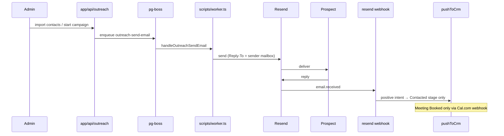

# Outreach Pipeline and Reply Flow

> Category: Architecture | Version: 1.0 | Date: May 2026 | Status: Active

Locked outreach rules: Reply-To mailbox, AI reply voice, CRM stage promotion limits, and Cal.com booking webhook — with code citations.

**Related:**
- [`../architecture/outreach-pipeline.md`](../architecture/outreach-pipeline.md)
- [`../architecture/crm-pipeline.md`](../architecture/crm-pipeline.md)
- [`../guides/locked-business-rules.md`](../guides/locked-business-rules.md)
- [`../api/routes-overview.md`](../api/routes-overview.md)
- [`CLAUDE.md`](../../../CLAUDE.md)

---

## Overview

Cold email runs as a **three-message sequence** per outreach contact, sent via Resend and scheduled through pg-boss. Inbound replies hit the Resend webhook, get AI analysis, and may push a CRM contact/deal. **Outreach never promotes a deal past `Contacted`** — only Cal.com `BOOKING_CREATED` moves to Meeting Booked.

---

## End-to-end flow



---

## Reply-To (LOCKED)

Outgoing outreach **must** set `Reply-To` to the sender's plain mailbox (`sender@email.__YOUR_DOMAIN__`). Never `reply+<uuid>@...`.

Campaign sends:

```236:251:lib/outreach/sending/sender.ts
    // ---------------------------------------------------------------------
    // CRITICAL: Reply-To MUST be the sender's plain mailbox.
    //
    // DO NOT change this back to `reply+UUID@domain` or any other synthetic
    // address. Recipients see Reply-To in their email client when they hit
    // "Reply", and a UUID-suffixed address looks fake / spam-like and damages
    // deliverability + trust.
    //
    // Inbound replies are matched back to the originating contact via the
    // In-Reply-To / References Message-ID headers in the reply (Resend uses
    // the send id as Message-ID). See lib/outreach/webhooks/events/received.ts.
    // ---------------------------------------------------------------------
    const replyTo = fromEmail;
```

Admin inbox replies: `app/api/outreach/replies/[replyId]/send/route.ts` (same rule; search `CRITICAL: Reply-To`).

**Inbound matching:** `lib/outreach/webhooks/events/received.ts` parses `In-Reply-To` / `References` against `outreach_contacts.email_{1,2,3}_resend_id`; from-address is fallback.

**Regression:** `app/api/outreach/replies/[replyId]/send/__tests__/route.test.ts` — *"sets Reply-To to the sender's plain mailbox"*.

---

## AI reply voice (LOCKED)

`lib/outreach/ai/reply-analyzer.ts` defines `SYSTEM_PROMPT` rules:

- Describe work as **custom/tailored systems** — never "AI automation" or "AI-powered".
- Australian English; no em-dashes.
- Banned phrases listed in prompt (update prompt text, not scattered code).
- Signoff: `Thanks,\n{sender_first_name}` via `senderFirstName` param.
- Calendar link verbatim: `__YOUR_CAL_LINK__`; pricing `$5,000 AUD+`, `4 to 8 weeks`.

**Eval harness:** `bun scripts/eval-replies.ts` (8 cases). **Tests:** `lib/outreach/ai/__tests__/reply-analyzer.test.ts`.

After prompt edits, restart dev server so webhook routes load the new module (Bun HMR caveat in `CLAUDE.md`).

---

## CRM stage promotion (LOCKED)

Pipeline slug: `sales-pipeline`. Stages: Lead → Contacted → Meeting Booked → Proposal Sent → Won / Lost.

**Outreach positive reply** calls `pushToCrm()` which always targets stage slug **`contacted`**:

```96:102:lib/outreach/crm/push-to-crm.ts
    // Outreach replies always land at "contacted". Only a real Cal.com booking
    // promotes a deal to "meeting-booked" — see app/api/webhooks/cal/route.ts.
    const [stage] = await db
      .select({ id: stages.id })
      .from(stages)
      .where(eq(stages.slug, "contacted"))
      .limit(1);
```

Contact status uses RPC `upsert_contact_with_hierarchy_protection` with `p_contact_status := 'lead'` — hierarchy never downgrades (subscriber < lead < qualified < customer).

**Cal.com booking** — `app/api/webhooks/cal/route.ts` uses `update_contact_and_deal_for_booking` RPC → contact `qualified`, deal **Meeting Booked**. AI reply intent does not override this.

---

## Cal.com webhook (LOCKED)

| Item | Value |
|---|---|
| Production URL | `https://hooks.__YOUR_DOMAIN__/api/webhooks/cal` |
| Handler | `app/api/webhooks/cal/route.ts` |
| DNS | `hooks` subdomain **grey-cloud** (DNS only) in Cloudflare |

Orange-clouding the apex or using the wrong host causes Cloudflare Bot Fight Mode **403** before Railway — bookings never update CRM. Full DNS rationale: `app/api/webhooks/cal/README.md`.

---

## Background processing

| Queue | Role |
|---|---|
| `outreach-send-email` | Send sequence 1/2/3 (`enqueueOutreachSendEmail`) |
| `outreach-process` | Cron `*/5 * * * *` — batch due contacts (`processDueEmails`) |

See [`../architecture/queue-and-worker.md`](../architecture/queue-and-worker.md).

---

## Related code

- `lib/outreach/sending/sender.ts` — outbound send + Reply-To
- `lib/outreach/webhooks/events/received.ts` — inbound reply
- `lib/outreach/ai/reply-analyzer.ts` — AI voice
- `lib/outreach/crm/push-to-crm.ts` — CRM push (Contacted only)
- `app/api/webhooks/cal/route.ts` — Meeting Booked promotion

---

## Related docs

- [`../architecture/crm-pipeline.md`](../architecture/crm-pipeline.md)
- [`../architecture/system-overview.md`](../architecture/system-overview.md)

---

## Changelog

- v1.0 (2026-05) — Locked Reply-To, AI voice, stage promotion, Cal.com webhook summary.
