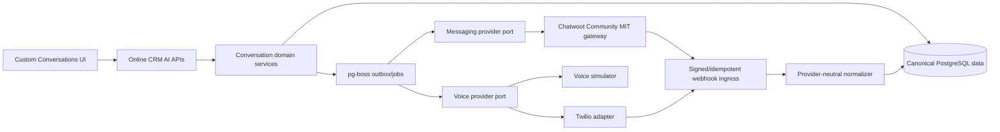

# Feature #010: Omnichannel Conversations Foundation

> **Online CRM AI** — Feature PRD #010
>
> **Status:** Planned
> **Priority:** P0
> **Effort:** XL (> 3d; execute as the milestones below)
> **Schema changes:** Additive, with an explicit legacy-read transition
> **Target:** Phase 0 vertical slice

---

## Phase Overview

### Problem statement

The inherited application has useful but separate CRM, outreach-email, inbox, automation, queue, and admin capabilities. It does not yet have a product-owned, tenant-safe conversation model capable of showing web chat, SMS, email, and voice activity together around one canonical contact. Online CRM AI needs that foundation before it can become a commercial US-first GoHighLevel replacement without making a gateway or communications vendor the system of record.

### Goals

- Establish Online CRM AI as the owner of canonical tenant, agent, contact, identity, thread, event, CRM, and workflow data.
- Deliver a custom contact-centered Conversations workspace that renders web chat, SMS, email, and a simulated or provider-backed call in one chronological timeline.
- Prove the Phase 0 path with exactly one seeded tenant, one authorized agent, and one canonical contact while keeping every schema and service boundary multi-tenant by construction.
- Use only Chatwoot Community Edition under its MIT-licensed terms as a headless messaging gateway behind an internal adapter for initial web chat, SMS, and email transport.
- Implement voice independently through an Online CRM AI voice-provider interface, with Twilio as the initial adapter and a deterministic simulator for local/CI testing.
- Create idempotent, replayable provider ingestion and outbound-send boundaries that preserve raw provider references without making provider objects canonical.

### Success indicators

- A tester can exchange or seed one inbound and one outbound event for web chat, SMS, and email, plus one call event, and see all events in deterministic chronological order on the same contact.
- Disconnecting Chatwoot or Twilio does not remove canonical conversation history already ingested into Online CRM AI.
- Replaying any provider webhook produces no duplicate canonical event.
- No product-facing route or component requires a Chatwoot identifier as its primary domain identifier.

### Scope

1. Additive canonical tenancy, membership, contact identity, conversation thread, conversation event, provider binding, webhook receipt, consent/suppression, and call tables.
2. Explicit reconciliation from inherited `contacts`, `contact_timeline`, `email_replies`, and `outreach_replies` into the new canonical model; no destructive replacement in Phase 0.
3. Internal messaging and voice contracts plus Chatwoot Community and Twilio/simulator adapters.
4. Signed inbound webhook intake, idempotent normalization, outbound command dispatch, delivery-status updates, and retry/dead-letter behavior.
5. A custom `/admin/conversations` workspace and contact timeline; Chatwoot UI is not embedded or exposed as the product UI.
6. Phase 0 fixtures/configuration for one tenant, agent, and contact, with tenant scope present on all canonical records and queries.
7. US-first consent, suppression, retention, audit, and recording controls suitable for later legal review.
8. Metrics/logging sufficient to trace a canonical event to a provider request or webhook receipt without logging message bodies or credentials by default.

### Out of scope / non-goals

- Feature parity with GoHighLevel, Chatwoot, Twilio Flex, or a full contact center.
- Multiple production tenants, self-service tenant provisioning, billing, marketplace integrations, mobile apps, or customer portals.
- AI-generated replies, autonomous sending, lead scoring, workflow builder UX, campaigns, bulk messaging, social DMs, WhatsApp, or MMS.
- Number porting, emergency calling, E911, call queues, IVR, conferencing, browser softphone, voicemail transcription, or call recording enabled by default.
- Replacing the inherited outreach/newsletter systems in this phase.
- Using Chatwoot as the canonical contact, thread, message, CRM, workflow, permission, or reporting store.
- Copying, linking, translating, or deriving from Chatwoot Enterprise-only source, features, tests, assets, documentation internals, or license-gated behavior.
- Guaranteeing legal compliance. The controls below are engineering requirements and must be reviewed against the launch facts by qualified US counsel.

### Dependencies

- **Inherited:** Next.js admin shell and auth (`app/admin/`, `proxy.ts`, `lib/auth.ts`), Drizzle/PostgreSQL (`lib/db/`), pg-boss (`lib/queue/`, `scripts/worker.ts`), CRM contacts/timeline (`lib/crm/`), and email inbox patterns (`app/api/outreach/replies/`, `lib/outreach/webhooks/`).
- **External runtime:** a separately deployed, pinned Chatwoot Community Edition instance; Twilio credentials/numbers only when provider-backed voice or SMS is exercised; existing email delivery configuration where selected.
- **Operational:** HTTPS webhook endpoints, environment-based secret injection, a dead-letter/replay runbook, and provider sandbox/test credentials outside source control.
- **Decision gates:** US communications/privacy counsel review before real external messaging or call recording; confirmation of Chatwoot Community source/tag and third-party notices before distribution.

---

## User Stories

### US-1 — Unified contact timeline

As an authorized agent, I can open one contact and see their web-chat messages, SMS messages, emails, and call activity in a single chronological timeline so I do not have to switch provider consoles.

**Acceptance criteria**

- Every visible item includes channel, direction, occurred time, delivery/status state, and human-readable content or call summary.
- Equal timestamps sort by a stable sequence/canonical ID, so refreshes do not reorder items.
- The timeline is sourced from Online CRM AI canonical records, not a live provider-history read.
- Provider identifiers are diagnostic metadata only and are not shown as primary product identifiers.

### US-2 — Identity resolution

As an agent, I can recognize that a web visitor, phone number, and email address belong to the same canonical contact while retaining provenance and avoiding an unsafe automatic merge.

**Acceptance criteria**

- Email addresses are normalized case-insensitively; phone numbers are normalized to E.164 when valid.
- Exact verified identity matches may attach automatically within the same tenant.
- Ambiguous or conflicting identities enter a review state; the system never merges contacts across tenants.
- A reversible audit entry records every link, unlink, and merge decision.

### US-3 — Messaging gateway independence

As a product operator, I can replace or temporarily disconnect Chatwoot without losing canonical contacts or conversation history.

**Acceptance criteria**

- The application calls an internal messaging adapter contract rather than Chatwoot-specific APIs from domain/UI code.
- Provider bindings map canonical entities to external objects and may be rebuilt.
- Inbound payloads normalize into provider-neutral events; unknown fields remain in a bounded diagnostic payload.
- Chatwoot outage states are visible, retried safely, and do not mutate accepted history.

### US-4 — Independent voice

As an agent, I can see a simulated or Twilio-backed call in the same timeline without routing voice ownership through Chatwoot.

**Acceptance criteria**

- Voice operations use the internal voice-provider contract.
- The simulator emits deterministic initiated/ringing/answered/completed or failed transitions for tests.
- A Twilio adapter can validate signed status callbacks and map them to the same canonical call/event model.
- Recording is off by default. If later enabled, consent policy, jurisdiction handling, retention, restricted playback, and deletion must be implemented first.

### US-5 — Consent and suppression

As an operator, I can prevent sends that lack the required consent or violate an opt-out/suppression record.

**Acceptance criteria**

- A centralized pre-send policy gate runs for SMS, email, and future automated voice sends.
- STOP-like SMS keywords create a channel/address-specific suppression and are acknowledged through the provider path where configured.
- Email unsubscribe/suppression and SMS opt-out records are independent, auditable, and checked before dispatch.
- Transactional/manual and marketing/automated purposes are distinguishable; Phase 0 defaults to one-to-one agent messaging, not campaigns.
- Quiet hours and calling-window policy use the contact's known timezone; unknown timezone fails closed for automated sends.

---

## Architecture

### Ownership and flow



### Architectural rules

1. **Canonical-first:** a provider callback is evidence about a domain event, not the domain event itself. Canonical IDs are generated and owned here.
2. **Tenant-first:** `tenantId` is mandatory on every canonical aggregate and provider binding. Authorization checks tenant membership before every read/write.
3. **Append-mostly events:** accepted message and call events are immutable except for constrained status progression and redaction/tombstone metadata. Corrections create audit events.
4. **Idempotent ingress:** persist webhook receipt/deduplication before normalization; uniqueness is `(provider, accountBindingId, externalEventId)` with a payload-hash fallback only where the provider supplies no stable ID.
5. **Transactional dispatch:** persist outbound event + outbox job atomically. Provider success stores the external reference; ambiguous timeout remains retryable and is reconciled before resend.
6. **Adapter quarantine:** Chatwoot/Twilio DTOs, status names, API clients, signatures, and errors stay in adapter modules. Domain services accept normalized contracts only.
7. **No dual authority:** provider contacts/inboxes/conversations may be projections, but product edits are applied to Online CRM AI first and synchronized outward.
8. **Chronology:** retain `occurredAt`, `receivedAt`, and provider sequence/reference separately. UI ordering is `occurredAt`, then provider sequence when trustworthy, then canonical ID.

### Provider Boundaries and Contracts

```ts
interface MessagingGateway {
  ensureContact(input: ProviderContactProjection): Promise<ExternalBinding>;
  ensureThread(input: ProviderThreadProjection): Promise<ExternalBinding>;
  sendMessage(command: SendMessageCommand): Promise<ProviderDispatchResult>;
  normalizeWebhook(input: VerifiedWebhook): Promise<NormalizedMessagingEvent[]>;
  health(): Promise<ProviderHealth>;
}

interface VoiceProvider {
  startCall(command: StartCallCommand): Promise<ProviderCallResult>;
  endCall(command: EndCallCommand): Promise<void>;
  normalizeCallback(input: VerifiedWebhook): Promise<NormalizedCallEvent[]>;
  health(): Promise<ProviderHealth>;
}
```

Contract requirements:

- Commands carry canonical tenant/contact/thread/event IDs and an idempotency key.
- Adapters return external IDs and normalized outcomes, never provider SDK objects.
- Capability flags describe supported channels/features; domain code must not infer them from provider names.
- Webhook verification happens before parsing into domain events.
- Provider credentials are server-only, encrypted at rest where persisted, redacted from logs, and rotatable without changing canonical IDs.

---

## Data Model Changes

Final table names may follow the repository's plural/camelCase Drizzle convention, but these concepts and constraints are required.

| Entity | Required fields / purpose | Key constraints and indexes |
|---|---|---|
| `tenants` | Canonical account boundary, name, status, timestamps | Primary UUID; slug unique |
| `tenant_memberships` | Agent-to-tenant membership and role | Unique `(tenantId, userId)`; Phase 0 links one existing admin user |
| `contacts` (extend or reconcile) | Canonical person/customer record | Add non-null `tenantId`; no global email uniqueness; index `(tenantId, updatedAt)` |
| `contact_identities` | Email, phone, web visitor, provider identity, verification/provenance | Unique verified `(tenantId, type, normalizedValue)` where policy permits; encrypted/tokenized sensitive values considered in implementation design |
| `conversation_threads` | Provider-neutral interaction grouping by contact/channel/inbox | `tenantId`, `contactId`, channel, state, subject, timestamps; index timeline queries |
| `conversation_events` | Unified inbound/outbound message, note, status, and call event stream | `tenantId`, thread/contact, channel, kind, direction, actor, content, `occurredAt`, `receivedAt`, status; immutable body with redaction markers |
| `provider_accounts` | Tenant-scoped Chatwoot/Twilio configuration reference and capability state | Secrets referenced through approved secret storage; never returned to clients |
| `provider_bindings` | Mapping from canonical entities to external account/contact/thread/message/call IDs | Unique `(providerAccountId, objectType, externalId)` and `(providerAccountId, objectType, canonicalId)` as appropriate |
| `webhook_receipts` | Verification result, external event ID, bounded payload or object-store reference, processing state | Unique dedup key; retention limit; payload encrypted/redacted according to data class |
| `outbound_commands` | Transactional outbox, idempotency key, attempts, next retry, terminal error | Unique `(tenantId, idempotencyKey)`; retry/status index |
| `channel_consents` | Address/channel/purpose consent evidence and revocation | Tenant/contact/identity scope; source, captured/revoked timestamps, policy version |
| `channel_suppressions` | STOP, unsubscribe, bounce, complaint, manual suppression | Unique active `(tenantId, channel, normalizedAddress, reasonClass)` |
| `calls` | Canonical call aggregate independent of voice provider | Tenant/contact/thread, direction, state, participants, start/answer/end, duration, recording state |
| `audit_events` | Security- and compliance-relevant actions | Append-only tenant/actor/action/target/time/request correlation |

### Event payload rules

- Use typed columns for routing, authorization, chronology, status, and commonly queried values; JSON is limited to versioned channel-specific details.
- Store text and sanitized rich content separately. Never render provider HTML without sanitization.
- Attachments are metadata references to controlled object storage, not provider URLs used as permanent records.
- Store provider timestamps and raw references for reconciliation, but canonical `createdAt`/`receivedAt` remain system-generated.
- Define event versioning from the first migration so future channels can evolve without rewriting history.

### Inherited-data transition

- Existing `contacts` are candidates for canonical contacts but require a tenant key and identity extraction.
- Existing `contact_timeline` remains readable during Phase 0; new communication events write to the canonical event model, not both stores indefinitely.
- Existing `email_replies` and `outreach_replies` are not canonical for omnichannel work. A repeatable migration/projection maps eligible records with source provenance and deduplication.
- No inherited table is dropped or renamed in Phase 0.

---

## API / Endpoint Specs

Exact route names may be adjusted during implementation, but the provider-neutral split is mandatory.

| Method | Proposed route | Purpose |
|---|---|---|
| GET | `/api/conversations` | Tenant-scoped list with contact/channel/unread filters and cursor pagination |
| GET | `/api/conversations/[threadId]` | Thread and ordered canonical events |
| POST | `/api/conversations/[threadId]/messages` | Validate policy, persist outbound event/outbox command, return canonical event |
| GET | `/api/contacts/[contactId]/timeline` | Cross-thread chronological timeline for one authorized tenant contact |
| POST | `/api/integrations/chatwoot/webhook` | Verify, dedupe, acknowledge quickly, enqueue normalization |
| POST | `/api/integrations/twilio/status` | Verify Twilio signature, dedupe, enqueue call/SMS normalization |
| POST | `/api/calls` | Start simulator or configured voice-provider call after authorization/policy checks |
| POST | `/api/calls/[callId]/end` | End active call through voice port |
| GET | `/api/integrations/health` | Redacted operator-only provider health/capability status |

API requirements:

- Session authentication plus tenant membership/role checks on every product endpoint.
- CSRF protection on browser state changes; provider webhooks use signatures and replay defenses instead of browser CSRF.
- Schema validation, body-size limits, bounded pagination, rate limits, structured errors, and request correlation IDs.
- Webhook endpoints return promptly after durable receipt and never perform slow provider calls inline.
- Responses expose canonical IDs only as primary IDs and never expose credentials or unbounded raw webhook bodies.

---

## UI/UX Description

- Add **Conversations** to the authenticated admin navigation.
- Desktop layout: filterable conversation list, selected contact/thread timeline, and contextual contact panel. Narrow screens collapse panes without losing keyboard access.
- Timeline interleaves channel cards with distinct icons/labels, direction, status, timestamp, sender, content, and call duration/outcome.
- Composer clearly indicates active channel and sender identity; send is disabled with a plain-language reason when provider health, consent, suppression, or identity requirements fail.
- Contact panel displays canonical identities and provenance, with ambiguous-link warnings rather than silent merge.
- Loading, empty, retrying, failed, duplicate/reconciled, and provider-disconnected states are designed explicitly.
- All interactive controls must be keyboard operable, visibly focused, labelled, screen-reader meaningful, and meet the product's WCAG 2.2 AA target. Automated checks supplement rather than replace manual testing.
- Message content is treated as untrusted. Rich email/chat HTML is sanitized; links are safely rendered; attachments do not execute inline.

---

## US-First Compliance Considerations

> Engineering requirements only, **not legal advice or a compliance certification**. Re-verify federal and state requirements against actual launch states, message purposes, providers, and customer contracts before production use.

| Area | Phase 0 requirement |
|---|---|
| SMS and automated calls | Capture consent evidence by identity, channel, purpose, source, time, and disclosure version. Distinguish one-to-one manual messaging from marketing/automated traffic. Enforce suppression and appropriate calling windows before dispatch. Obtain counsel review for TCPA and state-law exposure before real sends. |
| A2P registration | Treat Twilio/account registration, brand/campaign approval, sender identity, and throughput as operational prerequisites for production US application-to-person SMS; do not bypass provider/carrier registration. |
| Opt-out | Recognize common SMS stop keywords case-insensitively, suppress promptly, preserve revocation evidence, and prevent all adapters/workflows from bypassing the central gate. Email sends must honor unsubscribes, complaints, and bounces according to purpose. |
| Email | Preserve truthful sender identity, valid routing headers, unsubscribe behavior for commercial email, and inherited suppression history. Do not repurpose inherited outreach consent assumptions for omnichannel marketing. |
| Call recording | Off by default. Before enabling, define participant notice/consent for applicable one- and all-party state laws, recording access, retention, export, deletion, and provider configuration. A simulated call stores no audio. |
| Privacy | Provide data inventory, notice inputs, processor/vendor list, purpose limitation, access/export/correction/deletion workflows, retention schedules, and deletion propagation to gateways where contractually/technically possible. State privacy applicability and consumer-request mechanics require counsel review. |
| Monitoring and tracking | Do not add tracking pixels, session replay, or message-open tracking to the Conversations surface by default. Any later tracking requires a separate privacy/consent review. |
| Minors and sensitive data | Phase 0 is business-use software and must not be directed to children. Do not infer that terms alone are an age gate. Minimize sensitive message content in logs, analytics, fixtures, and support tooling. |
| Accessibility | Target WCAG 2.2 AA for the custom UI; include keyboard, focus, labels, contrast, announcements, and call/media controls in acceptance testing. |
| Customer controls | Surface tenant-configurable consent language, retention, quiet hours, and sender identity in later phases; Phase 0 may use controlled fixtures but must not hard-code legally meaningful claims as universal defaults. |

---

## Security Requirements

- Deny access unless the authenticated user has an active membership in the event/contact tenant. Never accept `tenantId` from the client as sufficient authority.
- Add cross-tenant negative tests for every list, detail, send, call, identity-link, replay, and export path.
- Verify Chatwoot webhook authenticity using the supported mechanism available in the pinned Community version and deployment. If authenticity cannot be cryptographically established, place ingress behind an independently authenticated relay/allowlisted private path; do not ship an unsigned public webhook assumption.
- Verify Twilio webhook signatures against the exact externally visible URL and raw request parameters/body before normalization.
- Store secrets only in approved server-side environment/secret storage; no secrets, provider tokens, recordings, or real customer data in Git, fixtures, logs, client bundles, or documentation.
- Apply replay protection, idempotency, timestamp/nonce checks where available, request size limits, rate limits, queue backpressure, and dead-letter quarantine.
- Sanitize untrusted HTML; validate attachment MIME/size/name; malware scanning and controlled object storage are prerequisites before real attachments are enabled.
- Encrypt transport; apply encryption at rest through the platform and field-level protection where the threat model requires it. Redact message bodies, phone numbers, emails, auth headers, and webhook payloads from default logs.
- Audit sends, call actions, identity changes, suppression overrides, replay attempts, provider configuration changes, and access to any future recordings.
- Prevent server-side request forgery: adapters use configured provider origins, strict timeouts, bounded redirects, and no user-supplied callback/fetch URLs.
- Use least-privilege provider credentials and separate test/staging/production accounts.
- Pin and scan dependencies/container images; produce a software bill of materials and license inventory for distributed artifacts.

---

## Clean-Room and License Boundaries

1. Chatwoot use is limited to **Community Edition material actually available under the MIT license** at a pinned upstream commit/tag. Preserve license and attribution notices required by that distribution.
2. Do not inspect, copy, port, decompile, recreate from restricted materials, or depend on Chatwoot Enterprise code, enterprise-only tests, assets, documentation internals, APIs, or features.
3. Chatwoot runs as a separately deployable headless gateway behind Online CRM AI contracts. No Community/Enterprise source is copied into first-party domain modules unless a later reviewed vendoring decision explicitly permits a specific MIT file with attribution.
4. Product schema, adapter interfaces, UI, workflows, and tests are written from this PRD, public provider contracts, and independently observed interoperability requirements. Record source/provenance for any borrowed MIT snippet.
5. Never represent Chatwoot, Twilio, or inherited Template CRM capabilities as authored by Online CRM AI. Maintain third-party notices and inherited provenance in distribution documentation.
6. Before release, run license scanning and manually verify that no Enterprise-only package, image, feature flag, route, asset, or copied source entered the repository or deployment.
7. “Compatible with” statements must not imply affiliation or endorsement; trademark use and customer-facing notices require review.

---

## Milestone Plan

### M0 — Inventory, decisions, and contracts

- Confirm inherited contact/inbox data paths and migration sources.
- Record the canonical ownership and Chatwoot Community-only decisions in an ADR before implementation.
- Define normalized channel/event/state enums and provider contracts.
- Pin the allowed Chatwoot Community source/version and create the license provenance checklist.

**Exit:** reviewed schema/contract proposal, data mapping, threat model, and compliance decision log.

### M1 — Canonical tenant/contact/identity foundation

- Add tenant, membership, contact tenant scope, identity, audit, consent, and suppression migrations.
- Seed one tenant, agent membership, contact, email identity, phone identity, and web identity with synthetic data.
- Add repository/service methods with tenant enforcement and identity-resolution tests.

**Exit:** canonical contact loads only for its tenant; ambiguous identity merge is reversible and audited.

### M2 — Thread/event/outbox foundation

- Add thread, event, provider account/binding, receipt, and outbound-command models.
- Implement ordered timeline query, idempotent receipt, transactional outbox, retries, and dead-letter state.
- Add migration projection for eligible inherited email/timeline data.

**Exit:** synthetic multi-channel events render in stable order and replay creates no duplicates.

### M3 — Chatwoot Community messaging adapter

- Deploy/configure the Community gateway outside this repo for development.
- Implement Community API/webhook adapter for web chat, SMS, and email capabilities selected for Phase 0.
- Reconcile external contact/conversation/message bindings and provider status changes.

**Exit:** at least one inbound and outbound event for each messaging channel traverses the adapter into canonical history, using sandbox/test destinations only.

### M4 — Independent voice adapter

- Implement deterministic simulator first.
- Implement optional Twilio call adapter and signed callback normalization.
- Render call lifecycle in the same thread/contact timeline; no recording.

**Exit:** simulated call always passes; Twilio sandbox/provider test is optional and skipped cleanly when credentials are absent.

### M5 — Custom Conversations workspace

- Build list, timeline, composer, channel/state indicators, contact context, and responsive/accessibility states.
- Add realtime update mechanism using existing SSE/PG patterns or a documented successor.
- Add policy-gate feedback without exposing provider internals.

**Exit:** one agent completes the Phase 0 end-to-end scenario entirely in Online CRM AI UI.

### M6 — Hardening and release gate

- Execute migration dry run/rollback rehearsal, webhook replay/load tests, authorization review, dependency/license scan, accessibility testing, and operational runbooks.
- Complete security review before quality review; resolve all release-blocking findings.
- Obtain legal review before real production external messaging/calling.

**Exit:** acceptance suite passes with synthetic/sandbox data and residual risks are explicitly accepted.

---

## Acceptance Criteria

| ID | Criterion |
|---|---|
| AC-1 | A synthetic Phase 0 fixture creates one tenant, one agent membership, one contact, and email/phone/web identities without real personal data or secrets. |
| AC-2 | Web chat, SMS, email, and call events for that contact appear in one custom timeline ordered deterministically by canonical chronology rules. |
| AC-3 | At least one inbound and outbound web-chat, SMS, and email event passes through the messaging adapter contract; tests may use a fake adapter while an opt-in sandbox suite validates Chatwoot Community. |
| AC-4 | A simulated call passes in all environments; when Twilio test credentials are explicitly supplied, signed call-state callbacks map to the same canonical call/event stream. |
| AC-5 | Replaying identical Chatwoot or Twilio webhook fixtures 10 times yields one canonical provider event and a traceable receipt history. |
| AC-6 | Outbound creation and outbox enqueue are atomic; a provider timeout never causes an untracked send and retry uses the same idempotency identity. |
| AC-7 | Removing provider availability leaves prior canonical history readable and presents a non-destructive disconnected/retrying state. |
| AC-8 | No domain/UI module uses a Chatwoot or Twilio ID as the canonical tenant, contact, identity, thread, event, CRM, workflow, or call ID. |
| AC-9 | All product endpoints deny unauthenticated access and cross-tenant access, including guessed canonical/provider IDs. |
| AC-10 | Provider webhooks reject invalid signatures/authentication and oversized or malformed payloads without persisting domain events. |
| AC-11 | The centralized send gate blocks an active SMS STOP suppression and email unsubscribe; no adapter or workflow can bypass the gate. |
| AC-12 | Recording is disabled in configuration and UI, and no audio object is created by the simulator or default Twilio path. |
| AC-13 | Rich message content is sanitized, logs are redacted, and no credentials or real contact data appear in source, test snapshots, or client bundles. |
| AC-14 | Legacy email/timeline projection is repeatable and deduplicated; rollback leaves inherited tables and reads intact. |
| AC-15 | License review verifies the pinned Chatwoot dependency/deployment is Community MIT only, required notices are present, and no Enterprise-only source or artifact is included. |
| AC-16 | Automated accessibility checks report no serious/critical violations on the Conversations route, and manual keyboard/focus/screen-reader smoke tests pass. |
| AC-17 | Operators can trace each event to its canonical request/job and provider receipt without viewing secrets or unrestricted raw payloads. |
| AC-18 | Phase 0 does not require Chatwoot UI, Chatwoot CRM/workflow data, a provider account in CI, or production sends/calls. |

---

## Test Strategy

### Unit and contract tests

- Identity normalization, tenant-scoped matching, ambiguous merge, consent/suppression, chronology, event state transitions, status precedence, and retry classification.
- Shared provider contract suite executed against fake messaging/voice adapters and each real adapter.
- Signature-verification fixtures, malformed/oversized payloads, stale/replayed callbacks, provider error mapping, HTML sanitization, and log redaction.
- License boundary guard that rejects known Enterprise-only packages/paths/artifacts and checks required third-party notices.

### Database and integration tests

- Fresh migration and upgrade migration from a representative inherited database snapshot.
- Unique constraints under concurrent duplicate webhooks and outbound requests.
- Transaction rollback proves no orphan event/job; dead-letter and replay prove idempotency.
- Every repository/query includes tenant scope; user A/tenant A cannot enumerate, read, mutate, send, replay, or link tenant B records.
- Legacy projection can run twice with identical results and reports unmapped/ambiguous records.

### End-to-end tests

- Synthetic browser scenario: sign in as seeded agent, open contact, ingest/send all three messaging channels, simulate call, refresh, and verify order/status.
- Provider-disconnected, delayed callback, failed send, suppression, invalid identity, and duplicate webhook scenarios.
- Accessibility via automated axe checks plus manual keyboard, focus order/visibility, labels, announcements, zoom/reflow, and contrast checks.
- Responsive checks for conversation list/timeline/contact panel at supported breakpoints.

### Opt-in provider tests

- Chatwoot Community and Twilio tests are tagged, use sandbox/test destinations, require explicit environment opt-in, and are excluded from ordinary CI.
- Provider tests clean up projections where supported but never delete canonical audit evidence merely to clean a provider account.
- No production number, mailbox, customer, call, or message is used in automated testing.

### Required verification commands (implementation phase)

Use the repository's existing checks and add focused suites without replacing them:

```bash
bun run lint
bun run format:check
bun run typecheck
bun run typecheck:worker
bun run test:run
bun run build:verify
```

---

## Migration and Rollback

### Migration

1. Back up the database and capture migration/journal state.
2. Deploy additive schema with nullable/backfillable tenant references where needed.
3. Seed the controlled Phase 0 tenant and bind the designated existing admin agent.
4. Backfill canonical tenant/contact identities in batches with dry-run counts, conflict reports, checkpoints, and deterministic source keys.
5. Project eligible inherited timeline/email records into canonical events using a unique source mapping.
6. Run shadow reads/comparison metrics before enabling canonical timeline reads behind a feature flag.
7. Enable fake adapters, then Chatwoot Community, then optional Twilio; enable outbound paths separately from inbound ingestion.
8. Preserve inherited reads until reconciliation metrics and acceptance tests pass.

### Rollback

- Disable Conversations and outbound provider feature flags first; pause workers without deleting queued evidence.
- Revert reads to inherited inbox/timeline paths. Additive writes remain preserved for diagnosis/export.
- Roll back application deployment before considering schema reversal.
- Do not drop canonical tables or remove tenant keys during emergency rollback. A later reviewed cleanup migration may remove additive schema only after export, retention, and reconciliation.
- Provider projections may be disconnected, but canonical history and audit receipts remain owned by Online CRM AI.
- Any outbound command with ambiguous provider outcome is reconciled before retry to avoid duplicate contact.

---

## Observability and Operations

- Correlate request ID, tenant ID, canonical event/command ID, job ID, webhook receipt ID, and redacted provider reference.
- Metrics: webhook accepted/rejected/duplicate, normalization failures, queue age, retry/dead-letter count, provider latency/error, event-ingest lag, outbound status age, identity conflicts, and blocked sends by policy reason.
- Alerts: signature failures spike, queue lag, dead letters, provider outage, status stuck beyond threshold, tenant-scope assertion failure, and license-scan failure.
- Runbooks required before provider-backed testing: provider outage, secret rotation, webhook replay, dead-letter recovery, duplicate/ambiguous send reconciliation, contact identity correction, and data deletion propagation.

---

## Files Touched (Expected Implementation)

These are planning targets, not changes made by this documentation task.

| Path | Expected role |
|---|---|
| `lib/db/schema.ts` | Canonical tenant/identity/thread/event/provider/consent/call schema |
| `lib/db/drizzle/<next>_omnichannel_foundation.sql` and `lib/db/drizzle/meta/*` | Additive migration and metadata |
| `lib/conversations/` | Domain types, repositories, services, chronology, policy gate |
| `lib/integrations/chatwoot/` | Community-only messaging adapter and normalizer |
| `lib/integrations/twilio/` | SMS/voice adapter and callback verification |
| `lib/integrations/voice-simulator/` | Deterministic local/CI voice adapter |
| `lib/queue/index.ts`, `scripts/worker.ts` | Outbox dispatch, normalization, retries/dead letters |
| `app/api/conversations/`, `app/api/contacts/[contactId]/timeline/` | Product APIs |
| `app/api/integrations/chatwoot/`, `app/api/integrations/twilio/` | Provider ingress |
| `app/api/calls/` | Provider-neutral voice commands |
| `app/admin/(dashboard)/conversations/` | Custom workspace route |
| `components/conversations/` | List, timeline, composer, channel/call event UI |
| `proxy.ts` | Webhook host/path policy if required by final ingress design |
| `.env.example` | Placeholder-only provider configuration names; no values |
| `THIRD_PARTY_NOTICES.md` or equivalent | Community MIT and other required notices |
| `library/knowledge-base/architecture/` | Post-decision ADR and implemented architecture docs |

---

## Risks and Mitigations

| Risk | Impact | Mitigation |
|---|---|---|
| Chatwoot becomes accidental system of record | Vendor lock-in and split truth | Canonical-first writes, binding tables, adapter contract, outage acceptance test |
| Chatwoot Community webhook authenticity differs by pinned version | Forged inbound events | Verify supported mechanism during M0; otherwise authenticated relay/private ingress; fail closed |
| Identity collision merges different people | Privacy breach and corrupted history | Tenant-scoped verified identities, ambiguity queue, reversible audited linking |
| Duplicate/ambiguous provider sends | Customer harm and cost | Transactional outbox, idempotency keys, receipt dedupe, reconcile-before-retry |
| Cross-tenant leakage in a future multi-tenant rollout | Critical confidentiality breach | Tenant key everywhere, centralized authorization, negative tests, no provider-ID lookup without tenant scope |
| US messaging/recording rules vary by purpose/state | Legal and customer exposure | Recording off, marketing automation out of scope, consent provenance, centralized suppression, counsel gate |
| Enterprise-license contamination | Distribution and commercial risk | Pinned Community source, provenance log, CI license guard, manual release review |
| Legacy email records conflict with canonical event model | Lost/duplicated chronology | Additive projection, source IDs, dry-run report, shadow reads, rollback flag |
| Provider outage or rate limits | Delayed/failed messaging | Capability health, backoff, queue metrics, dead letters, explicit UI state |
| Message HTML/attachments carry malicious content | XSS/malware/data exfiltration | Sanitize HTML; defer real attachments until validation/scanning/storage controls exist |
| Phase 0 shortcuts hard-code one-tenant assumptions | Expensive rewrite | One tenant in fixtures only; required tenant scope and membership in production model/contracts |

---

## Open Questions / Decision Gates

- [ ] Which Chatwoot Community tag/commit and deployment topology are approved for Phase 0?
- [ ] Which Chatwoot Community-supported inbox integrations will carry SMS and email initially, and does SMS flow directly through Twilio or through Chatwoot for messaging only?
- [ ] Is Phase 0 outbound email transactional/manual only, or may it exercise a commercial-message unsubscribe path with test addresses?
- [ ] What is the canonical retention period for message bodies, raw webhook receipts, audit events, and future recordings?
- [ ] Which US states and customer industries are targeted at launch, and what additional consent/recording/privacy terms does counsel require?
- [ ] Should inherited `contacts` be evolved in place or migrated behind a compatibility view after tenant scoping?
- [ ] Which realtime transport should succeed the inherited SSE/PG listener pattern at initial scale?
- [ ] What customer-visible terminology replaces inherited “Inbox” while both old and new surfaces coexist?

---

## Related

- [`../feature-001-crm-pipeline/prd-feature-001-crm-pipeline.md`](../feature-001-crm-pipeline/prd-feature-001-crm-pipeline.md) — inherited CRM contact/deal capabilities
- [`../feature-003-inbox-and-ai-replies/prd-feature-003-inbox-and-ai-replies.md`](../feature-003-inbox-and-ai-replies/prd-feature-003-inbox-and-ai-replies.md) — inherited email-only inbox patterns
- [`../../../knowledge-base/architecture/system-overview.md`](../../../knowledge-base/architecture/system-overview.md) — inherited runtime and subsystem map
- [`../../../knowledge-base/architecture/database-schema.md`](../../../knowledge-base/architecture/database-schema.md) — inherited schema inventory
- [`../../../knowledge-base/architecture/decisions/README.md`](../../../knowledge-base/architecture/decisions/README.md) — ADR log for the accepted architectural decisions governing this feature
- [`../../../knowledge-base/architecture/decisions/0001-own-canonical-data-behind-provider-neutral-adapters.md`](../../../knowledge-base/architecture/decisions/0001-own-canonical-data-behind-provider-neutral-adapters.md) — canonical ownership and adapter boundary
- [`../../../knowledge-base/architecture/decisions/0002-use-chatwoot-community-as-headless-gateway-only.md`](../../../knowledge-base/architecture/decisions/0002-use-chatwoot-community-as-headless-gateway-only.md) — Chatwoot Community-only headless gateway boundary
- [`../../../knowledge-base/architecture/decisions/0003-implement-voice-behind-an-independent-provider-interface.md`](../../../knowledge-base/architecture/decisions/0003-implement-voice-behind-an-independent-provider-interface.md) — independent voice interface, Twilio-first adapter, and simulator
- [`../../../knowledge-base/architecture/decisions/0004-begin-with-a-modular-monolith-and-worker.md`](../../../knowledge-base/architecture/decisions/0004-begin-with-a-modular-monolith-and-worker.md) — modular monolith plus worker topology
- [`../../../../README.md`](../../../../README.md) — product landing and inherited-capability summary

---

## Changelog

- 2026-09-08 — Added links to ADR-0001 through ADR-0004 recording the feature's accepted architectural decisions.
- 2026-09-08 — Planned Feature #010 for Online CRM AI Omnichannel Conversations Foundation and Phase 0 vertical slice.
